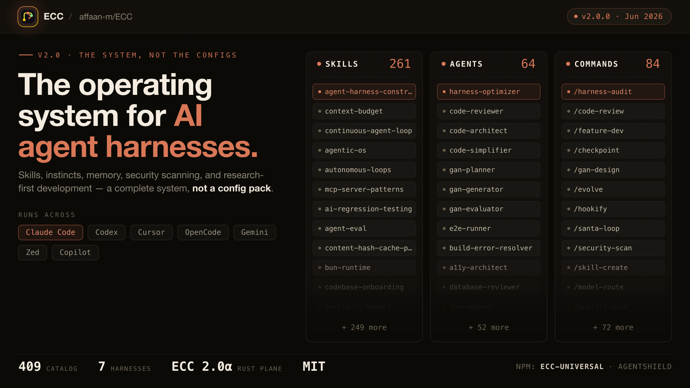

#AI #Агенты #Coding #MCP #Skills #Harness #Инструменты

# ECC

Операционная система для AI-агентов: skills, hooks, rules, MCP и control-plane для Codex, Cursor, Claude Code, OpenCode, Gemini и терминальных сценариев.

Не набор разрозненных конфигов, а цельная harness-система: агенты, навыки, безопасность, обучение на сессиях и операторские паттерны, заточенные под ежедневную разработку продуктов.

## Возможности

- Универсальная установка через `npx ecc-universal setup` для нескольких AI-харнесов
- Каталог агентов, skills, hooks, rules и MCP-конвенций в одном репозитории
- AgentShield и практики безопасности для агентных рабочих процессов
- Dashboard GUI и прототип control plane ECC 2.0 на Rust (`ecc2/`)
- Выборочная установка компонентов по манифестам и инкрементальные обновления
- Руководства по токенам, памяти, верификации и оркестрации субагентов

## Стек

- TypeScript / Node.js (`ecc-universal`, плагины и интеграторы)
- Python (dashboard и вспомогательные скрипты)
- Rust (`ecc2/` - alpha control plane)
- Shell, Markdown, схемы JSON и конфиги для Cursor, Codex, OpenCode, Claude и других сред

## Быстрый старт

```bash
npx ecc-universal setup
```

Если npm ругается на версию или кэш:

```bash
npm view ecc-universal version
npx ecc-universal@latest setup
```

Dashboard:

```bash
npm run dashboard
# или
python3 ecc_dashboard.py
```

## Архитектура

ECC собирает переиспользуемый слой навыков и хуков поверх разных агентных сред, а ECC 2.0 добавляет операторский control plane: сессии, статус, daemon и dashboard.

Обложка проекта:



## Лицензия

MIT. Файл `LICENSE` сохранён вместе с исходными копирайтами.
